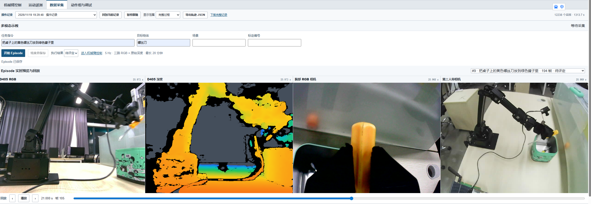
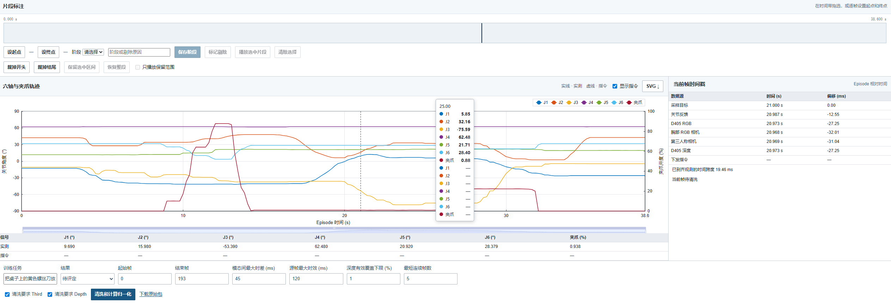
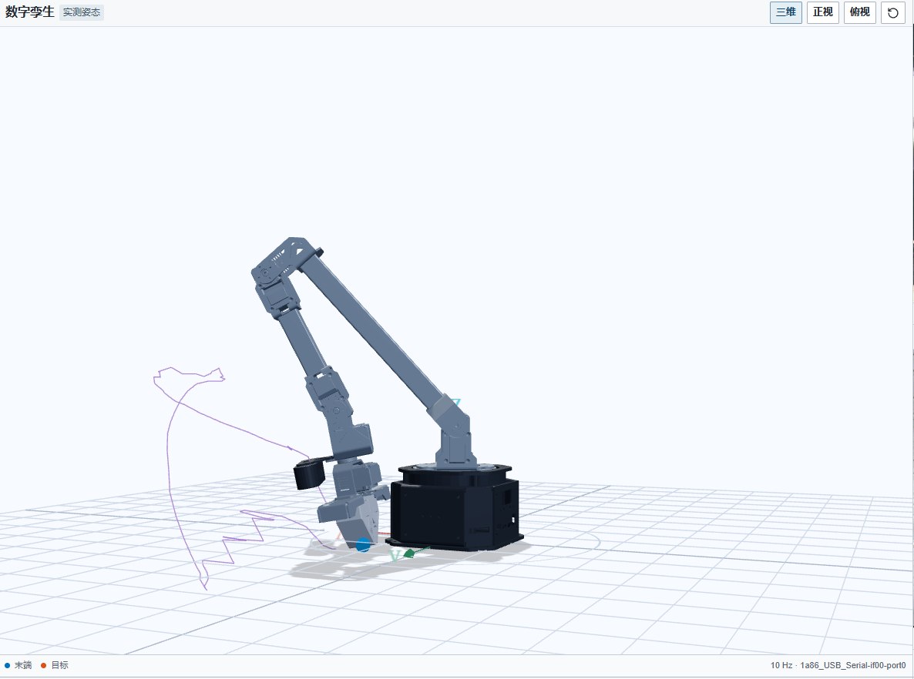
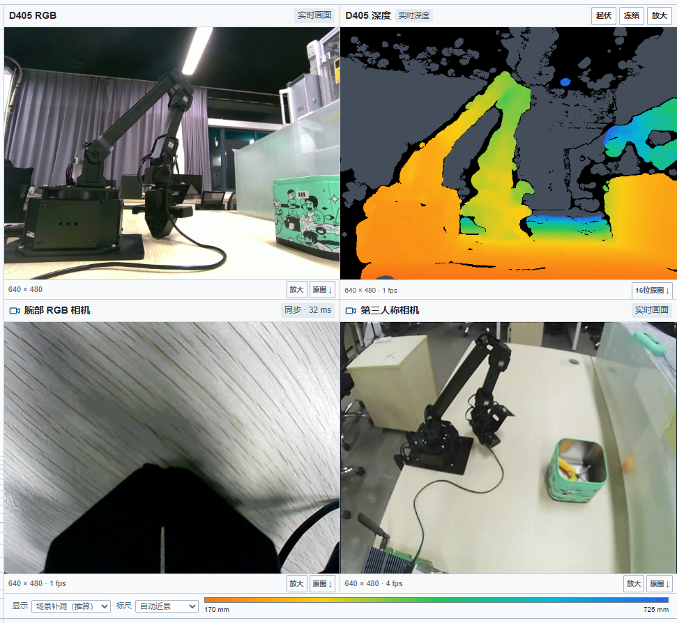

# NexArm Console

NexArm 六舵机机械臂的浏览器工作台，集成数字孪生、XYZ 与关节控制、运动遥测和历史轨迹。Linux 示教工作台支持四路同步采集、录制中回看、阶段标注、手动裁剪和 ACT 训练包导出。

详细使用说明见 [WORKBENCH.md](WORKBENCH.md)，Linux 部署及 D405 配置见 [DEPLOYMENT.md](DEPLOYMENT.md)，独立抓取实验见 [Grasp Lab](experiments/grasp-lab/README.md)。

## 界面预览

### 四路 Episode 回放

以「把黄色螺丝刀放入绿色罐子」的示教为例，同一行可查看 D405 RGB、原始深度的可视化、腕部 RGB 和第三人称 RGB。拖动时间轴可逐帧查看夹取和放置过程。

[](docs/screenshots/episode-replay.png)

### 片段标注、裁剪与同步轨迹

在时间带上设起止帧，保存任务阶段或裁剪保留范围。下方的六轴与夹爪轨迹共用 Episode 时间轴，右侧时间戳表显示各路观测与采样点的偏移，便于检查同步质量。

[](docs/screenshots/episode-annotation-and-telemetry.png)

### 数字孪生与末端轨迹

数字孪生按关节反馈更新姿态。紫色线条显示已记录的末端路径，右上角可切换三维、正视和俯视视角。

[](docs/screenshots/digital-twin.png)

### 控制页实时监看

控制页以 2×2 布局同时显示三路 RGB 和 D405 深度。深度预览支持调整显示标尺、冻结和放大，也可单独下载原始 16 位图。

[](docs/screenshots/four-camera-monitor.png)

## 环境要求

- 四路示教使用 Linux、FFmpeg、V4L2、两台 USB RGB 相机和一台 RealSense D405。D405 通过 `requirements-depth.txt` 安装可选依赖，启动时加 `--depth-camera`。设备选择和 SDK 平台要求见 [Linux 部署](DEPLOYMENT.md#optional-realsense-d405-depth)。
- macOS 下的腕部 RGB 采集使用 Swift 和 AVFoundation。请安装 Xcode Command Line Tools（`xcode-select --install`），并在系统提示时授权使用相机。
- Python 3.9 或以上，Node.js 20.19+ 或 22.12+，以及支持 WebGL 的现代浏览器。
- 首次构建需访问 npm、PyPI 和 GitHub 原始文件服务。后续构建会复用本地缓存的模型文件。

## 启动

在仓库根目录执行：

```sh
./start.sh
```

脚本创建 Python 虚拟环境、安装缺失的依赖、准备官方模型、构建前端并启动 HTTP 服务。打开 [本机控制台](http://127.0.0.1:8765/)。如果有多个 USB 串口，或相机没有自动识别，显式指定设备：

```sh
./start.sh --device /dev/cu.usbserial-XXXX --camera-device "icSpring"
```

`--port` 可修改主服务端口，默认 `8765`。浏览器显示「USB 已连接」后，点击「启用控制」获得控制权。在前台终端按 Ctrl+C 关闭服务。

## 操作

工作台分为「机械臂控制」「运动遥测」「数据采集」「动作组与调试」四页。可用页签切换，浏览器返回键可回到上一页。

1. **移动到 XYZ**。基座坐标以毫米为单位。可输入 XYZ，也可用「三维选点」拖动 X/Y/Z 箭头或按毫米步长微调，并旋转视角确认深度。「确认目标并检查路径」或「检查路径」会预检可达性和几何碰撞；修改目标后需重新检查，再点击「移动到目标」执行。蓝点表示根据编码器估算的当前工具点，橙点表示目标。
2. **设置关节角度**。手动输入 J1–J6 的目标角度（°），只对修改过的轴下发目标。「动作组与调试」中的单轴点动可按 °/s 设置速度上限。J6 控制夹爪开合。
3. **观察反馈**。控制页显示数字孪生和四路相机，腕部画面在能匹配编码器反馈时会同步实测姿态。预览保留画面比例，采集包保存完整 RGB JPEG 和原始深度。「运动遥测」包含六轴角度、角速度、角加速度、夹爪开度、末端坐标及跟踪误差。速度和加速度从实测编码器按时间差分并滤波。夹爪开度按模型行程换算百分比。曲线用 Apache ECharts 渲染，可导出 SVG，采用 [MATLAB 的浅色 gem 配色](https://www.mathworks.com/help/matlab/ref/matlab.graphics.axis.axes-properties.html)。工作空间热图显示模型可达采样集的 XY 投影，颜色表示每个网格的样本数。
4. **停止运动**。使用页面的「停止」取消后续指令，并请求保持实测位置。板载动作由连接机械臂的本机控制台停止。

XYZ 逆运动学从当前姿态和多组候选初值求解，优先维持工具朝向并保留夹爪开度。规划器先验证关节解及六轴行程，再搜索直达路径或通过碰撞验证的绕行路径。执行时在新的编码器采样上连续下发限幅前瞻位置，轴跟踪持续偏差时从实测姿态重新求解。几何预检通过后仍需实机反馈验收。末端 XYZ 容差 3 mm，执行异常时界面报告对应关节及实测偏差。

「三维选点」保留当前观察视角，显示高度参考平面、可达采样、目标坐标和地面投影。点击平面使用精确坐标，不改选附近采样点；拖动三维箭头可独立修改基座 X/Y/Z。确认后从当前实测姿态预检路径，选点本身不发起运动。修改模型或工位配置后，用 `.venv/bin/python scripts/sample-workspace.py` 更新采样，再构建页面。

「复位」使用 [工位配置](src/workcell.json) 中的 `park_positions`，从当前实测姿态寻找直达或分阶段路径。找不到通过检查的路径时会报错。如果已有动作在运行，先停止并重新启用控制。

动作组支持编辑、电脑在线运行以及 JSON `.d6a` 导入导出。坐标和手动运动使用 LeRobot 桥接协议。桥接时电压显示为切换协议前的测量值。需要板载下载、擦除或校准时，重启服务以恢复板载模式。只有当前服务已记录并检查过的板载动作组可从控制台启动。

## 数据采集与训练

1. 在「数据采集」填写任务指令，可补充目标物体、场景和标定编号。点击「开始 Episode」，再到「机械臂控制」进行示教。
2. 采集页以一行四列显示已写入的最新画面，轨迹图和逐帧时间戳在下方更新。拖动时间轴可回看已保存的部分，后台继续录制。点击「回到实时」跟随最新帧。
3. 结束并保存后，拖选时间带或逐帧设置起点和终点，再保存阶段。阶段写入对应帧的 `stage` 字段，与任务文本和成功或失败结果分别保存。
4. 用「裁掉开头」「裁掉结尾」或「保留选中区间」确定范围，普通播放可只播保留范围。可恢复整段，也可标记中间的剔除区间。清洗报告显示时差、剔除原因和可用于训练的连续片段。
5. 可下载完整原始包。标记为成功且清洗后仍有可用片段的 Episode 可下载训练包，内含保留且通过检查的帧和对应阶段。

| 画面顺序 | 训练字段 | 数据 |
| --- | --- | --- |
| D405 RGB | `observation.images.front` | JPEG |
| D405 深度 | `observation.depth` | 原始 16 位 Z16，包含深度比例和内参 |
| 腕部 RGB | `observation.images.wrist` | JPEG |
| 第三人称 RGB | `observation.images.third` | JPEG |

示教默认以 5 Hz 记录，四路默认尺寸均为 640×480。D405 RGB 和深度来自同一帧组。平台使用主机单调时钟对齐各路相机、关节反馈与已下发指令，分别保留源时间戳。默认清洗要求四路画面齐全，模态间时差不超过 45 ms，源帧时效不超过 120 ms。

训练用的 `observation.state` 保存实测值，`action` 保存实际下发的目标。两者均为六维，前五维是 J1–J5 的角度，末维是从 J6 换算的夹爪 0–1 开度。采集数据保存在主控电脑的 `.data/episodes/`，ZIP 包含 `manifest.json`、`frames.jsonl`、`segments.jsonl`、`events.jsonl` 和各路媒体。

### 转换为 LeRobot ACT 数据集

在训练机安装 LeRobot 0.4.4，将同一训练划分的已清洗 ZIP 一起转换为 [LeRobotDataset v3](https://huggingface.co/docs/lerobot/v0.4.4/lerobot-dataset-v3)。

```sh
python -m pip install 'lerobot==0.4.4'
python scripts/export-episodes-lerobot.py demo-a-training.zip demo-b-training.zip --output datasets/nexarm-train
lerobot-train --dataset.repo_id=nexarm/teaching --dataset.root=datasets/nexarm-train --policy.type=act --policy.push_to_hub=false
```

转换默认使用 D405 RGB、腕部 RGB、任务文本、关节状态和动作。清洗时要求第三人称画面后，可加 `--third` 将它纳入数据集。深度和阶段标签保存在训练 ZIP，供按阶段筛选或适配其他模型。

## 局域网

在可信局域网中使用。两个 LAN 入口使用 HTTP Basic 登录，用户名为 `nexarm`，分别使用至少 12 个字符的密码。先在相应的终端为变量设置本机密码，再运行命令。下面的 IP 是示例，请换成本机和获授权电脑的实际局域网 IPv4。

| 入口 | 默认端口 | 用途 |
| --- | --- | --- |
| `127.0.0.1` | `8765` | 主控电脑，含板载维护 |
| 主控电脑局域网 IPv4 | `8765` | 登录后查看相机和实测反馈 |
| 主控电脑局域网 IPv4 | `8766` | 授权电脑可控制 XYZ、关节和在线动作组 |

**开启局域网查看**。在设置了 `NEXARM_LAN_PASSWORD` 的终端启动主服务：

```sh
./start.sh --lan-host 192.168.1.10
```

**开启局域网控制**。保持主服务运行，在另一个设置了 `NEXARM_CONTROL_PASSWORD` 的终端启动网关：

```sh
.venv/bin/python -m nexarm.lan_control --host 192.168.1.10 --peer 192.168.1.20
```

从 `--peer` 指定的电脑访问 `http://192.168.1.10:8766/`，登录后点击「启用控制」。网关与本机控制台共享同一控制会话，同一时间只允许一个操作者。若主服务使用了自定义端口，为网关加 `--upstream-port` 指定主服务端口。

## 工位与模型

- [六轴参数](src/joints.json) 定义关节名称、常规编码器范围、模型零位、方向和比例。参数来自厂商 URDF 和[舵机配置](https://github.com/Hiwonder/NexArm/blob/0eb4fb8d806454fa1ff753f6a5ad305c63acceb4/src/driver/servo_controller/config/servo_controller.yaml)。起点已在常规范围外时，规划允许保持或往范围内退回。
- [工位配置](src/workcell.json) 定义工具点偏移、工作台高度、连杆包围盒、自碰撞检查对和静态障碍。可以在 `obstacles` 中添加 `{"name":"挡板","min_mm":[100,-50,0],"max_mm":[125,40,90]}`。修改 JSON 后重新构建并启动，让后端规划和前端显示同时加载新配置。
- 障碍位置和工具点需根据现场标定。碰撞检测使用近似几何，覆盖已配置的静态物体，RGB 相机负责预览。执行前请确认机械臂附近人员和物体的位置。
- 三维网格和模型来自 [Hiwonder NexArm](https://github.com/Hiwonder/NexArm/tree/0eb4fb8d806454fa1ff753f6a5ad305c63acceb4/src/simulations/nexarm_description)。上游的模型包未填写明确的许可证，项目在构建时从该提交下载原文件并校验 SHA-256，再生成浏览器可用的 URDF。模型文件保存在被 Git 忽略的 `public/model/`。

| 舵机 | 关节 | 常规模型角度 |
| --- | --- | --- |
| J1 | 底座旋转 | −119.7° 至 119.7° |
| J2 | 肩部俯仰 | −89.9° 至 57.2° |
| J3 | 肘部俯仰 | −179.9° 至 17.2° |
| J4 | 腕部俯仰 | −37.8° 至 89.9° |
| J5 | 腕部旋转 | −119.7° 至 119.7° |
| J6 | 夹爪开合 | 0.0° 至 28.6° |

控制页并排显示当前反馈与常规行程，运动遥测页提供六轴区间图。

## 工程结构

| 路径 | 职责 |
| --- | --- |
| `src/` | Vite、Three.js 前端，含控制台、数字孪生、相机视图、曲线和共享工位参数 |
| `nexarm/server.py` | 串口通信、运动执行、控制会话、HTTP 接口 |
| `nexarm/kinematics.py` | 正逆运动学、关节约束、路径和碰撞检查 |
| `nexarm/lan_control.py` | 局域网操作入口，校验指定来源并转发操作 |
| `nexarm/camera_feed.py`、`camera/` | 宿主端相机帧读取和 macOS RGB 采集助手 |
| `nexarm/episodes.py` | 四路示教录制、同步、片段标注、清洗和 ZIP 导出 |
| `scripts/export-episodes-lerobot.py` | 将清洗后的训练 ZIP 转成 LeRobot v3 数据集 |
| `scripts/fetch-model.py` | 下载、校验并转换官方模型 |
| `start.sh` | 初始化依赖、构建并启动 |

## 分步构建与诊断

只构建网页和模型时，执行 `npm ci` 和 `npm run build`，产物在 `dist/`。从源码手动启动主服务：

```sh
python3 -m venv .venv
.venv/bin/python -m pip install -r requirements.txt
npm ci
npm run build
camera/build.sh  # macOS，需要相机时运行
.venv/bin/python -m nexarm.server
```

运行 `.venv/bin/python -m unittest discover -s tests -v` 可复测截图中的目标和舵机滞后保护，无需连接硬件。

- **USB 未连接**。确认串口设备名，关闭占用该串口的厂商软件，再检查服务是否收到六轴反馈。
- **相机无画面**。确认腕部相机已接入、编译了采集助手、macOS 已授予相机权限，并用 `--camera-device` 指定设备名称。
- **远端显示「仅查看」**。查看使用 `8765`。确认控制网关已启动，从授权电脑使用 `8766` 并点击「启用控制」。

## 提交说明

推送 GitHub 前检查本 README。涉及界面、采集流程、数据格式、依赖或启动方式的变更，将相应说明与代码一并提交。
